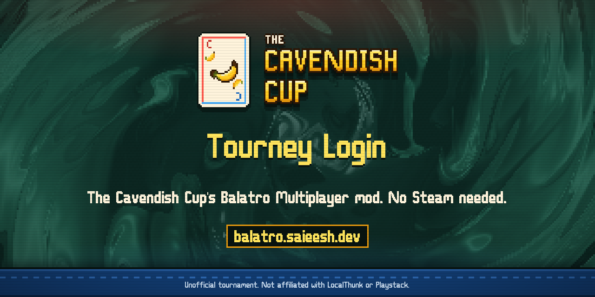

# Joining The Cavendish Cup

The tournament runs on our own Balatro Multiplayer server. Setup takes about five minutes, and you don't need Steam running. These are the same steps as on **[balatro.saieesh.dev](https://balatro.saieesh.dev)**, where you also register and find the Discord and WhatsApp group.

**You need your own copy of Balatro** on Windows or Mac.

## 1. Install the mods

The easiest way is **BET** (https://balatromp.com/download):

1. Open BET's **Settings** and point it at your Balatro game. Auto-Detect usually finds it.
2. In your profile, add **Multiplayer PvP**. It brings in Multiplayer API. Both need to be **version 1.0.7 or newer**.
3. Download **[TourneyLogin.zip](https://github.com/saieeshb/balatro-tourney-login/releases/latest/download/TourneyLogin.zip)**. Then click **+ Add Local Mod**, choose the zip, and make sure **Tourney Login** is in your profile.

## 2. Set your name

1. Press **Run** in BET.
2. In the game, open **Mods → Tourney Login → Config**.
3. Type the name you registered with, press **Save name**, and restart the game.

If you skip this, you'll show up as `Player-xxxx`, or under your Steam name if Steam is running.

## 3. Play

Open the multiplayer menu and choose **PvP**. The first time, the server shows a notice and asks your age. For each match, join the lobby code your match organiser gives you.

## Ruleset: Balanced

Matches use the **Balanced** ruleset: near-vanilla Balatro with a few changes for PvP. Hanging Chad, Bloodstone, Reserved Parking and Glass are reworked, Justice is banned, and there are no Multiplayer-only cards.

You play head to head on the same seed, with Red Deck at White Stake and 4 lives. From ante 2, every boss blind is a PvP blind: the higher score wins, and the loser loses a life.

- **Failing an ordinary blind** also costs a life. You get some comeback money whenever you lose a life.
- **Clock:** once your opponent is ready, they can start your 150-second clock. It gets 60 seconds longer for each blind you've skipped ahead. If it runs out, you lose a life, every time.
- **The Order** is on, so both players get cards from the same fixed sequence. Score preview is allowed.

To practise, open the PvP menu, choose **Practice** and pick **Balanced**.

## Mods and fair play

Only mods on the Balatro Multiplayer **approved list** are allowed: cosmetic, language and listed quality-of-life mods. Mods on its **banned list** mean disqualification. Examples include Talisman, Cryptid, Brainstorm, DVPreview, Showman, and anything that speeds the game above 4x or previews your deck.

[Approved and banned mods list](https://docs.google.com/spreadsheets/d/1SR-Grf99e53-zODE8B7qGX53Jv1mNPqMVV9yFZGWv50)

The server records which mods each player has installed, and organisers check them before matches.

## After the tourney

Disable or remove **Tourney Login** in BET to play on the official server again. Nothing else needs undoing.

## Not using BET?

Put these in your `Mods` folder:

- Steamodded
- Lovely
- Multiplayer API 1.0.7 or newer
- Multiplayer PvP
- the `TourneyLogin` folder from the zip

On Mac the folder is `~/Library/Application Support/Balatro/Mods`. On Windows it's `%AppData%\Balatro\Mods`.

## Problems?

- **Can't connect:** check that both multiplayer mods are 1.0.7 or newer, and that the tournament is live. Then ask in the WhatsApp group or on Discord, both linked at [balatro.saieesh.dev](https://balatro.saieesh.dev).
- **Wrong name:** set it again in **Mods → Tourney Login → Config**, then restart the game.

Names on this server aren't verified, so play under your own name. This is an unofficial community tourney, not affiliated with LocalThunk or Playstack.
