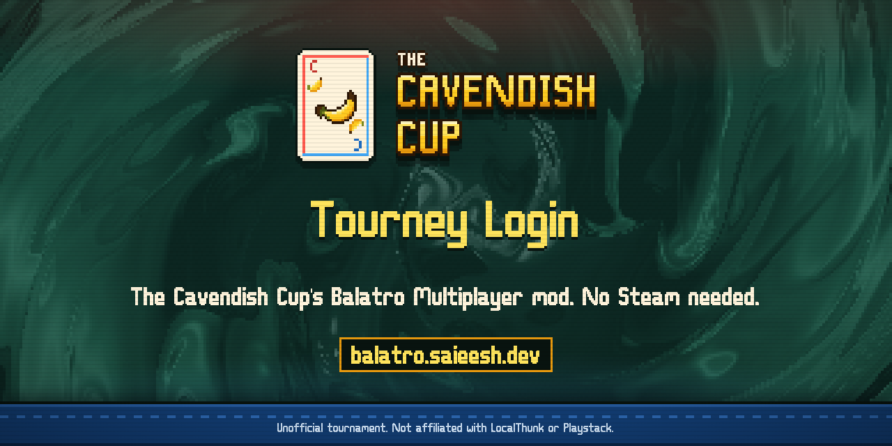

<p align="center">
  <a href="https://balatro.saieesh.dev"></a>
</p>

<p align="center">
  <a href="https://github.com/saieeshb/balatro-tourney-login/releases/latest/download/TourneyLogin.zip"></a>
  <a href="https://balatro.saieesh.dev"></a>
  <a href="LICENSE"></a>
</p>

Tourney Login is the companion mod for **[The Cavendish Cup](https://balatro.saieesh.dev)**, a free, unofficial Balatro PvP tournament. It runs alongside [Balatro Multiplayer](https://github.com/Balatro-Multiplayer/BalatroMultiplayerPvP), and its mod id is `NoSteamLogin`.

**Playing in the tournament?** Everything you need, from registering to joining a match, is at **[balatro.saieesh.dev](https://balatro.saieesh.dev)**. [PLAYERS.md](PLAYERS.md) has the same steps.

## What it does

 **Points the game at the tournament server**, `balatro.saieesh.dev`. This happens in memory only and never changes Multiplayer API's own settings, so disabling the mod puts the game back on the official server.

 **Logs in without the Steam client.** The mod saves a login id in the Balatro save folder (`nosteam_login_id.txt`), so you keep the same account every launch. If Steam is running, it uses your Steam account instead.

 **Lets you pick your name.** In game, go to **Mods → Tourney Login → Config**, type it, press **Save name**, and restart the game.

It never logs in to the official server without Steam, because that server checks real Steam tickets.

## Install

###  Get the multiplayer mods

Install **BET** from [balatromp.com/download](https://balatromp.com/download) and point it at your game. In your BET profile, add **Multiplayer PvP**, which brings **Multiplayer API** with it. Both need to be **1.0.7 or newer**.

###  Add Tourney Login

Download **[TourneyLogin.zip](https://github.com/saieeshb/balatro-tourney-login/releases/latest/download/TourneyLogin.zip)**. In BET, click **+ Add Local Mod**, choose the zip, and make sure **Tourney Login** is in your profile.

###  Set your name

Press **Run**, open **Mods → Tourney Login → Config**, type the name you registered with, press **Save name**, and restart the game.

Not using BET? Put Steamodded, Lovely, Multiplayer API, Multiplayer PvP and the `TourneyLogin` folder from the zip in your `Mods` folder yourself.

## Settings

These live in `config.lua`:

| Key | Default | Meaning |
|---|---|---|
| `server_host` | `balatro.saieesh.dev` | Tournament server. Set it to `''` to use Multiplayer API's own setting. |
| `server_port` | `443` | |
| `server_secure` | `true` | Uses TLS. |
| `display_name` | `''` | Set this in game instead. |

If Multiplayer API's own `use_custom_server` setting is on, it overrides the server set here. The organiser's own machine uses that to connect locally.

The name you save in game goes to `config/NoSteamLogin.jkr` in the save folder. Only the name is saved there, so a later change to the server settings still reaches every player.

## Test

```sh
luajit tests/provider_test.lua path/to/MultiplayerAPI
```

This loads the API's real `steam.lua`, `dev.lua` and `lifecycle.lua` with the game stubbed out. It then checks which server and login each setup gets: default, custom server, and preset off. It also checks the saved name.

## Licence

GNU General Public License v3.0. See [LICENSE](LICENSE).

The Cavendish Cup is an unofficial community tournament, not affiliated with LocalThunk or Playstack.
